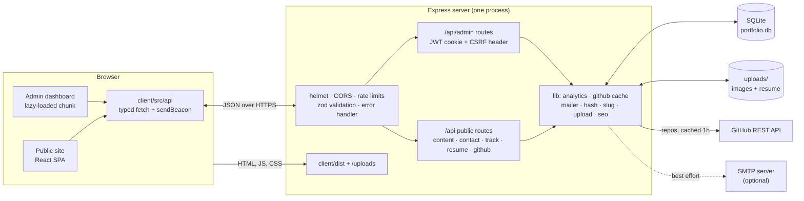
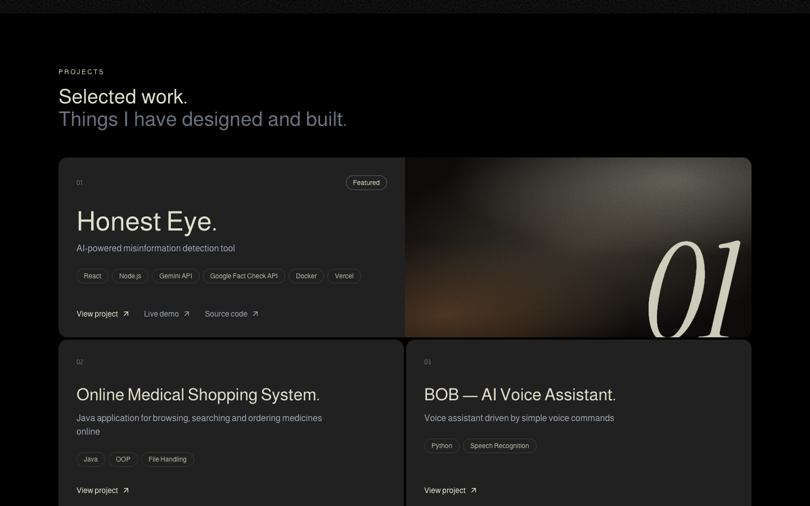
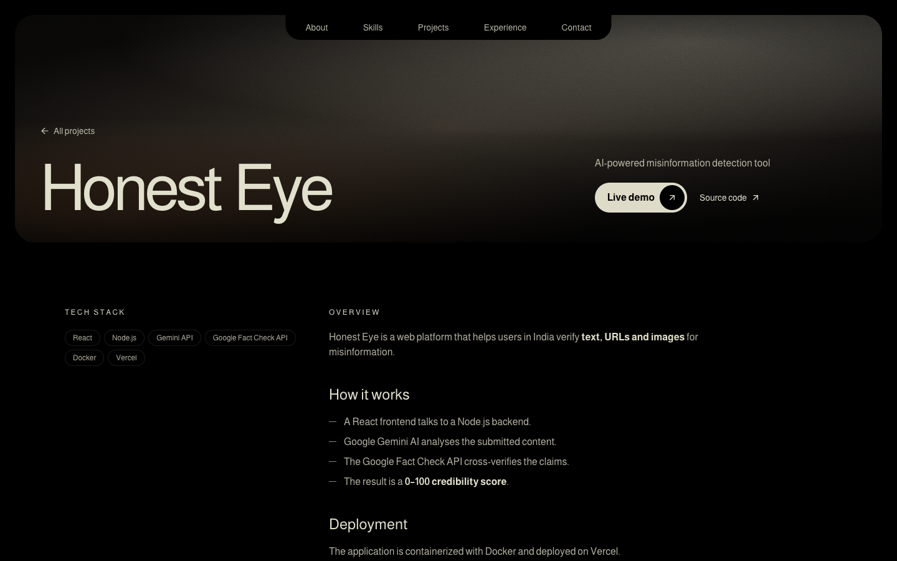
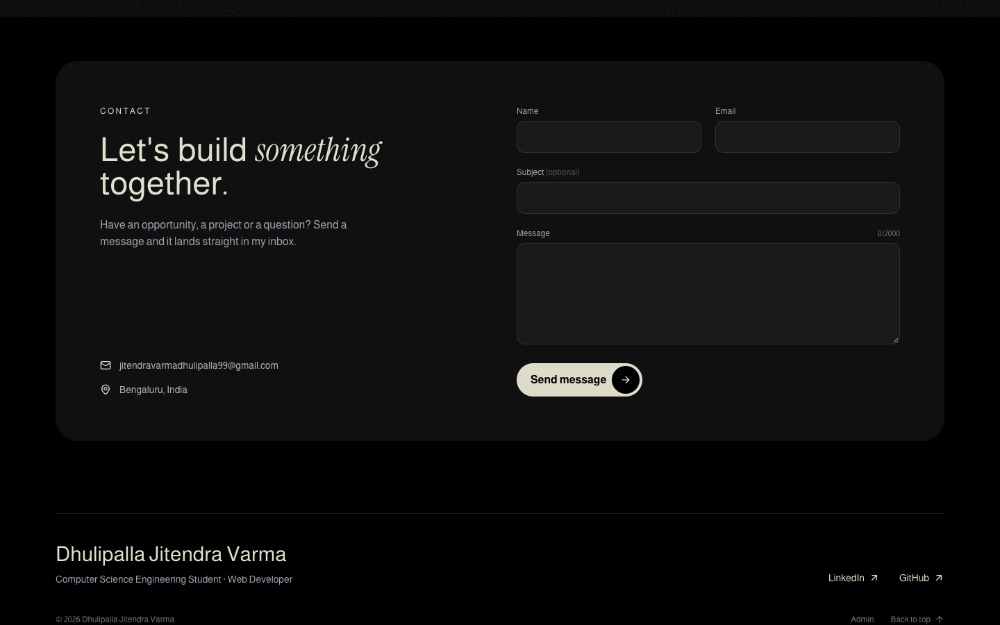
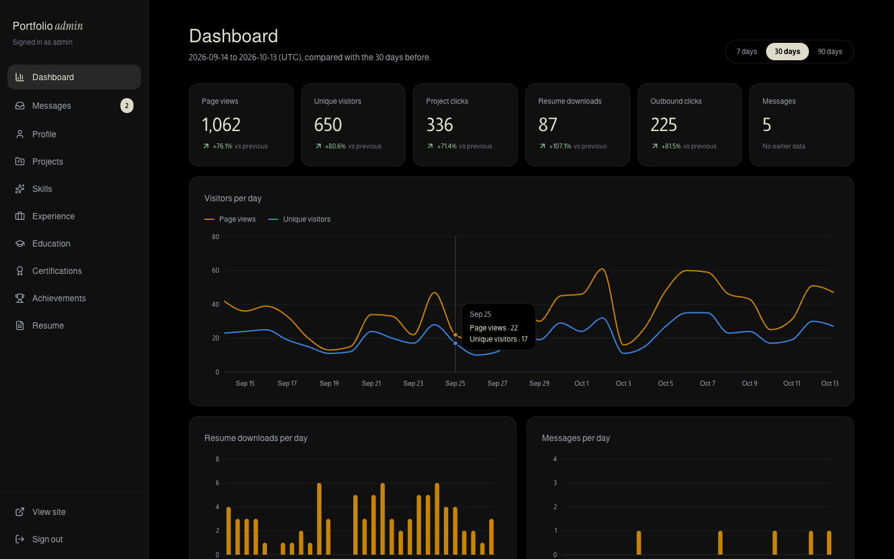
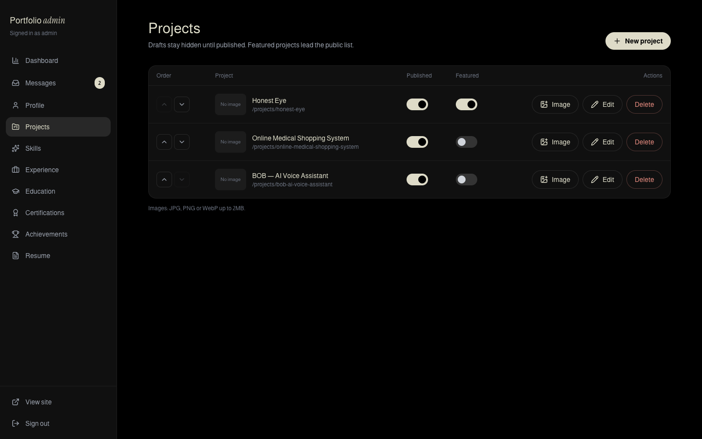
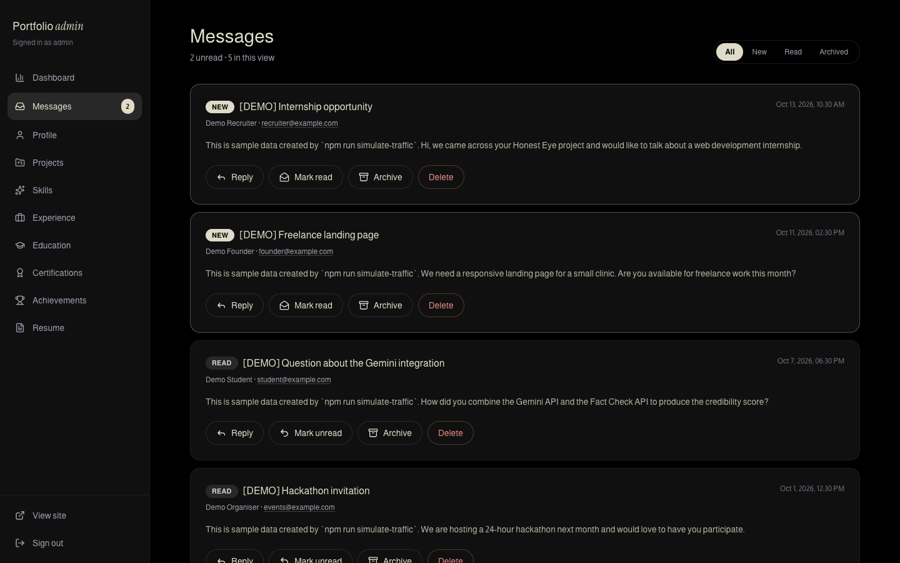

# Dhulipalla Jitendra Varma · Portfolio Platform

A full-stack personal portfolio that is **edited from a dashboard instead of a code editor**, **keeps every recruiter message**, and **shows who is visiting without tracking anyone**. One Node process serves a JSON content API, an admin dashboard, a contact inbox, privacy-friendly analytics, resume download tracking and a cached GitHub feed, backed by a single SQLite file.


## Contents

- [Problem Statement](#problem-statement)
- [Objectives](#objectives)
- [Features](#features)
- [Tech Stack](#tech-stack)
- [Architecture](#architecture)
- [Database Schema](#database-schema)
- [API Reference](#api-reference)
- [Security](#security)
- [Privacy-Friendly Analytics](#privacy-friendly-analytics)
- [Project Structure](#project-structure)
- [Setup](#setup)
- [Screenshots](#screenshots)
- [Design Decisions](#design-decisions)
- [Challenges](#challenges)
- [Known Limitations](#known-limitations)
- [Future Work](#future-work)
- [License](#license)

## Problem Statement

Most student portfolios are static pages, and static pages have three recurring problems:

1. **They go stale.** Adding a project or fixing a typo means editing HTML and redeploying, so the site quietly falls behind the resume.
2. **They give the owner no insight.** There is no way to know whether anyone visited, which project drew attention, or whether the resume was downloaded, short of adding a third-party tracker that sets cookies and needs a consent banner.
3. **They lose recruiter messages.** A `mailto:` link depends on the visitor's mail client, and a form wired straight to email silently drops messages when SMTP fails or lands in spam.

## Objectives

- Make all portfolio content **data, not markup**: stored in a database, served by an API, edited in a dashboard.
- **Never lose a message**: store every contact submission first, treat email as an optional copy.
- Give the owner **useful analytics with no cookies, no raw IP addresses and no third parties**.
- Know when the **resume** is downloaded.
- Show **live GitHub repositories** without exhausting GitHub's rate limit or breaking when GitHub is down.
- Keep the backend **secure by default** (hashed passwords, httpOnly sessions, CSRF protection, rate limits, validated uploads).
- Keep the frontend **fully API-driven and separable**, so it can be redesigned without touching the server.
- Stay **cheap and simple to run**: one process, one SQLite file, no external services required.

## Features

**Public site**

- Single page with Hero, About, Skills, Projects (featured first), GitHub repositories (live), Experience, Education, Certifications, Achievements and Contact, plus a detail page per project with a Markdown write-up.
- Contact form with inline validation, a honeypot, rate limiting and clear success and error states.
- Resume download link (appears once a PDF is uploaded) that is counted server-side.
- SEO: server-rendered title, description, Open Graph tags and JSON-LD `Person` schema, `sitemap.xml` and `robots.txt`.
- Respects `Do Not Track` and `prefers-reduced-motion`.

**Admin dashboard (`/admin`)**

- Analytics: page views, unique visitors, project clicks, resume downloads, outbound clicks and messages, each with % change against the previous period, charts per day and top-N lists. Ranges: 7, 30 or 90 days.
- Messages inbox: filter by status, mark read or unread, archive, delete, reply by email, unread badge.
- Content editors for the profile (including the "show phone number" switch), projects (publish and feature toggles, reorder, image upload, Markdown description) and skills, experience, education, certifications and achievements.
- Resume upload and replacement.

**Backend**

- Versioned SQL migrations that run on boot, and an idempotent seed that also runs automatically on an empty database.
- GitHub repositories cached for an hour in memory and SQLite, with a stale fallback when GitHub is unreachable.
- Optional SMTP notification for new messages that can never fail the request.
- 74 automated tests (Vitest + Supertest).

## Tech Stack

| Technology | Purpose |
| --- | --- |
| Node.js 20+ (ES modules) | Server runtime |
| Express 5 | HTTP API, static file serving, SPA fallback |
| SQLite via `better-sqlite3` | Embedded database: one file, synchronous queries, transactions |
| `zod` | Request validation with field-level error messages |
| `bcryptjs` | Admin password hashing |
| `jsonwebtoken` + `cookie-parser` | Signed session token in an httpOnly cookie |
| `helmet` | Security headers and Content Security Policy |
| `cors` | Allow-list for a separately hosted frontend |
| `express-rate-limit` | Per-IP limits on login, contact, tracking and the API |
| `multer` | Multipart upload parsing (memory storage, size limits) |
| `nodemailer` | Optional email copy of contact messages |
| `dotenv`, `cross-env` | Configuration and portable npm scripts |
| React 18 + Vite | Client application and build tool |
| TypeScript | Typed API layer and components |
| React Router | Client-side routing, protected admin routes |
| Tailwind CSS 3 | Styling, driven by CSS variables in `theme.css` |
| `framer-motion` | Pull-up text, card entrances, scroll-linked reveal |
| `lucide-react` | Icons |
| `marked` + `DOMPurify` | Render and sanitise project Markdown |
| `recharts` (lazy-loaded) | Dashboard charts |
| Vitest + Supertest | API and unit tests |
| Playwright | Automated README screenshots |
| npm workspaces + `concurrently` | Monorepo and one-command development |

## Architecture



Request flow: every request passes through `helmet`, CORS and JSON parsing. Public routes are rate limited and validated with zod. Admin routes additionally require the CSRF header and a valid session cookie. Route handlers stay thin and delegate to `lib/` services, which are plain functions that take the database handle, so they are tested directly without HTTP.

In production the same process serves the built client from `client/dist`, injecting SEO tags into `index.html` per route. In development Vite serves the client and proxies `/api` and `/uploads` to Express, so the browser always sees one origin.

## Database Schema

SQLite file at `DB_PATH` (default `./data/portfolio.db`). Migrations in `server/src/migrations/*.sql` run in order on boot and are recorded in `_migrations`.

| Table | Columns | Notes |
| --- | --- | --- |
| `profile` | `id` (always 1), `name`, `headline`, `summary`, `email`, `phone`, `show_phone` (default 0), `location`, `linkedin_url`, `github_url`, `resume_file`, `updated_at` | Single row, enforced by `CHECK (id = 1)` |
| `skills` | `id`, `category`, `name`, `sort_order` | Grouped by category in the API |
| `projects` | `id`, `slug` UNIQUE, `title`, `tagline`, `description_md`, `tech_stack` (JSON), `live_url`, `repo_url`, `image`, `featured`, `published`, `sort_order`, `created_at`, `updated_at` | Only `published = 1` rows are public |
| `experience` | `id`, `role`, `company`, `start`, `end`, `bullets` (JSON), `sort_order` | |
| `education` | `id`, `degree`, `institution`, `start`, `end`, `score`, `sort_order` | |
| `certifications` | `id`, `title`, `issuer`, `url`, `sort_order` | |
| `achievements` | `id`, `title`, `description`, `sort_order` | |
| `messages` | `id`, `name`, `email`, `subject`, `body`, `status` (`new`, `read`, `archived`), `created_at`, `ip_hash` | Index on `(status, created_at)` |
| `events` | `id`, `type` (`page_view`, `project_click`, `resume_download`, `outbound_click`), `path`, `ref`, `visitor_hash`, `created_at` | Index on `(type, created_at)` |
| `admin` | `id`, `username` UNIQUE, `password_hash` | bcrypt hash |
| `cache` | `key`, `value` (JSON), `fetched_at` | Durable copy of the GitHub response |
| `_migrations` | `name`, `applied_at` | Migration bookkeeping |

## API Reference

All responses are JSON. Every error has the same shape: `{ "error": "message", "details": [{ "path": "field", "message": "..." }] }` (`details` only on validation errors).

### Public API (`/api`)

| Method | Path | Description |
| --- | --- | --- |
| GET | `/health` | Liveness and database check |
| GET | `/portfolio` | Everything for the first render in one payload. `ETag` + `Cache-Control: public, max-age=60` |
| GET | `/profile` | Profile. `phone` is included only when `show_phone = 1`. `has_resume` tells the client whether to show the download link |
| GET | `/skills` | Skills grouped by category |
| GET | `/projects` | Published projects in display order. `?featured=1` filters to featured |
| GET | `/projects/:slug` | One published project (404 for drafts) |
| GET | `/experience`, `/education`, `/certifications`, `/achievements` | Lists in display order |
| POST | `/contact` | `{ name 2–60, email, subject ≤100, body 10–2000 }`. Honeypot field `website`. 5 per hour per IP. Returns `201 { ok: true }` |
| POST | `/track` | `{ type, path, ref? }`. Type must be one of the four event types. Returns `204`. 60 per minute per IP |
| GET | `/resume` | Streams the resume PDF as an attachment and records a `resume_download`. `404` if none uploaded |
| GET | `/github/repos` | `{ username, repos: [{ name, description, language, stars, forks, updated_at, url }], stale, fetched_at }`. Forks excluded |

Site root: `GET /sitemap.xml` (home page plus every published project) and `GET /robots.txt`.

### Admin API (`/api/admin`)

All routes except `login`, `logout` and `me` require the session cookie. Every non-GET request must send `x-requested-with: portfolio`.

| Method | Path | Description |
| --- | --- | --- |
| POST | `/login` | `{ username, password }`. Sets the session cookie (8 hours). 5 failed attempts per 15 minutes per IP |
| POST | `/logout` | Clears the cookie |
| GET | `/me` | Current session, `401` if signed out |
| GET | `/stats?days=30` | Analytics (1 to 365 days): `totals` with `value`, `previous`, `change_pct`; `visitors_per_day`; `top_pages`; `top_projects`; `resume_downloads_per_day`; `outbound_clicks`; `messages_per_day` |
| GET, PUT | `/profile` | Read (including `phone` and `show_phone`) and partially update the profile |
| POST, DELETE | `/resume` | Upload (multipart field `file`, PDF ≤5MB, replaces the old file) or remove the resume |
| GET, POST | `/projects` | List all projects including drafts; create (slug generated from the title and made unique) |
| GET, PUT, PATCH, DELETE | `/projects/:id` | Read, update (partial; `PATCH { published }` or `{ featured }` for the toggles), delete |
| PATCH | `/projects/reorder` | `{ ids: [...] }` sets the display order |
| POST, DELETE | `/projects/:id/image` | Upload (JPG, PNG or WebP ≤2MB, field `file`) or remove the project image |
| GET, POST | `/skills`, `/experience`, `/education`, `/certifications`, `/achievements` | List and create |
| PUT, DELETE | `/<collection>/:id` | Update (partial) and delete |
| PATCH | `/<collection>/reorder` | `{ ids: [...] }` |
| GET | `/messages?status=&page=&limit=` | Paginated inbox: `{ items, total, page, limit, pages, unread }` |
| GET | `/messages/unread-count` | `{ unread }` |
| PATCH | `/messages/:id` | `{ status: "new" | "read" | "archived" }` |
| DELETE | `/messages/:id` | Delete a message |

## Security

| Area | Measure |
| --- | --- |
| Passwords | bcrypt (cost 12). Seeding refuses passwords under 10 characters. Unknown usernames are compared against a dummy hash so timing does not reveal which usernames exist |
| Sessions | JWT (HS256, 8 hour expiry) in a cookie that is `HttpOnly` (unreadable by scripts), `SameSite=Strict` (never sent cross-site), `Secure` in production and scoped to `/api` |
| CSRF | Mutating admin requests must carry `x-requested-with: portfolio`. A cross-site form cannot set custom headers, and a cross-site `fetch` that tries triggers a CORS preflight that only `CLIENT_ORIGIN` passes |
| Rate limits | Login 5 failures per 15 minutes, contact 5 per hour, tracking 60 per minute, general API 300 per minute, all per IP. `trust proxy` is set to exactly one hop in production so the address cannot be spoofed |
| Input validation | zod schemas on every body and query. URLs must be `http(s)`. JSON bodies are capped at 100kb |
| Uploads | Type decided by **magic bytes**, not filename or `Content-Type`. Size limits (2MB images, 5MB PDF). Files are stored under random names, so user input never reaches a filesystem path. Served with `X-Content-Type-Options: nosniff` |
| XSS | React escapes all content. Project Markdown is rendered with `marked` and sanitised with DOMPurify. The CSP allows scripts only from the site itself |
| Headers | `helmet` defaults plus a CSP limited to own assets, Google Fonts and the one media origin used by the background video |
| SQL injection | Parameterised statements everywhere. Table and column names are only ever taken from static maps |
| Spam | Honeypot field that returns the same `201` as a real submission, so bots get no signal |
| Errors | One central handler. 5xx responses never leak internals |
| Analytics | Hashed, salted, cookie-free (next section) |

## Privacy-Friendly Analytics

The dashboard answers "how many people visited and what did they look at" without identifying anyone:

1. **No cookies and no local storage.** Nothing is stored on the visitor's device, so there is nothing to consent to.
2. **No raw IP addresses.** For each event the server computes

   ```
   DAILY_SALT   = SHA-256(SERVER_SECRET + ":" + UTC date)
   visitor_hash = SHA-256(ip + "|" + user-agent + "|" + DAILY_SALT)
   ```

   and stores only `visitor_hash`. The IP is used in memory for the hash and for rate limiting, then discarded.
3. **The salt rotates every day and is never stored.** The same visitor produces a different hash tomorrow, so visits cannot be linked across days. This is exactly enough to count unique visitors per day, and no more.
4. **The hash cannot be reversed or recomputed** without `SERVER_SECRET`.
5. **Bots are ignored** by user-agent, so crawlers and uptime monitors do not inflate the numbers.
6. **`Do Not Track` is honoured**: the client sends nothing when `navigator.doNotTrack === '1'`. The admin area is never tracked.
7. **Only four event types** are accepted, and only the path and referrer are recorded with them.
8. **No third parties**: no analytics script, no external requests, data never leaves the server.

Trade-off: "unique visitors" over a range is the sum of daily uniques, so someone who visits on three days counts three times. That is the price of not being able to follow people.

## Project Structure

```
.
├── package.json                 npm workspaces + root scripts
├── .env.example                 documented configuration
├── render.yaml                  Render blueprint (web service + disk)
├── scripts/
│   └── screenshots.mjs          Playwright capture against a temp build
├── docs/screenshots/            README images
├── server/
│   ├── seed/
│   │   ├── data.js              resume content (single source of truth)
│   │   ├── seed.js              idempotent seed + GitHub repo linking
│   │   └── run.js               `npm run seed`
│   ├── scripts/
│   │   └── simulate-traffic.js  demo events + demo messages
│   ├── src/
│   │   ├── index.js             boot: config, db, auto-seed, listen, shutdown
│   │   ├── app.js               Express app factory (no listen, testable)
│   │   ├── config.js            environment parsing
│   │   ├── db.js                connection + migration runner
│   │   ├── migrations/          001_init.sql, 002_cache.sql
│   │   ├── middleware/          auth, validate, rateLimits, errors
│   │   ├── lib/                 analytics, github, mailer, hash, slug, upload, content, seo
│   │   └── routes/
│   │       ├── public/          content, contact, track, resume, index (health, github, SEO)
│   │       └── admin/           auth, profile, projects, collections, messages, schemas, index (stats)
│   └── tests/                   9 files, 74 tests
└── client/
    ├── index.html
    ├── tailwind.config.js       maps Tailwind colours to theme.css variables
    └── src/
        ├── api/                 ALL data access, one module per resource
        ├── styles/theme.css     every design token (colours, fonts, easing)
        ├── styles/index.css     base styles, component classes, noise textures
        ├── components/          WordsPullUp, ScrollRevealText, Navbar, PillButton, Seo, ...
        ├── sections/            Hero, About, Skills, Projects, Repos, Timeline, Credentials, Contact, Footer
        ├── pages/               Home, ProjectDetail, NotFound
        ├── admin/               Login, Layout, Dashboard, Charts, editors, Messages, Resume
        └── lib/                 design constants, formatting, usePortfolio
```

## Setup

### Requirements

- Node.js 20 or newer and npm 9 or newer.

### Install and configure

```bash
npm install
cp .env.example .env
```

Then edit `.env`:

- `SERVER_SECRET`: 32+ random characters. Generate one with
  `node -e "console.log(require('crypto').randomBytes(48).toString('hex'))"`.
- `ADMIN_USERNAME` and `ADMIN_PASSWORD`: your dashboard login. **The password must be at least 10 characters. Change it from the placeholder before deploying.**

| Variable | Default | Purpose |
| --- | --- | --- |
| `PORT` | `4000` | Server port |
| `NODE_ENV` | `development` | `production` enables static serving, secure cookies and proxy trust |
| `DB_PATH` | `./data/portfolio.db` | SQLite file |
| `UPLOAD_DIR` | `./uploads` | Uploaded images and resume |
| `SERVER_SECRET` | required | Signs sessions and salts analytics hashes |
| `ADMIN_USERNAME`, `ADMIN_PASSWORD` | required | Admin account created by the seed |
| `GITHUB_USERNAME`, `GITHUB_URL` | owner's account | Repository feed and profile link |
| `GITHUB_TOKEN` | optional | Raises the GitHub limit from 60 to 5000 requests per hour |
| `LINKEDIN_URL` | owner's profile | Profile link |
| `CLIENT_ORIGIN` | `http://localhost:5173` | CORS allow-list |
| `SITE_URL` | optional | Canonical base URL for the sitemap and Open Graph tags |
| `SMTP_HOST`, `SMTP_PORT`, `SMTP_USER`, `SMTP_PASS`, `SMTP_TO` | optional | Email a copy of each contact message |

### Run

```bash
npm run dev      # API on :4000, client on :5173 (open http://localhost:5173)
```

The first start creates the database, runs the migrations and seeds it. The admin dashboard is at `/admin`.

Production mode (one process serving the API and the built client):

```bash
npm run build
npm start        # http://localhost:4000
```

### Seed

```bash
npm run seed
```

Idempotent. It fills only empty tables, so it never duplicates rows or overwrites dashboard edits. It always updates the admin password from `.env`, which makes it the way to reset or rotate the password. It also links a project to a public GitHub repository when the names clearly match (for example "Honest Eye" and `HONEST-EYE`).

### Demo data

```bash
npm run simulate-traffic              # 60 days of demo events + 5 demo messages
npm run simulate-traffic -- --clear   # remove them again
```

Demo rows are clearly marked: every demo `visitor_hash` starts with `demo-` and every demo message subject starts with `[DEMO]`. Do not run this against a live database you care about unless you intend to clear it afterwards.

### Test

```bash
npm test          # 74 tests, in-memory database, no network access
npm run typecheck # TypeScript check of the client
```

### Screenshots

```bash
npx playwright install chromium   # once
npm run screenshots
```

The script builds the client, starts the server on a free port with a **temporary** database, seeds it, simulates traffic, signs in and captures the images listed below into `docs/screenshots/`, then shuts everything down and deletes the temporary data. If Google Chrome is installed it is used so the background video is captured; otherwise the bundled Chromium is used and the gradient fallback is shown.

### Deploy (Render)

1. Push the repository to GitHub and create a **Blueprint** on Render from `render.yaml`.
2. Set `ADMIN_USERNAME`, `ADMIN_PASSWORD` and, once known, `SITE_URL` (for example `https://your-app.onrender.com`). `SERVER_SECRET` is generated for you.
3. The service builds with `npm install && npm run build`, starts with `npm start` and is health-checked at `/api/health`.

**Persistence:** the database and uploads are files. `render.yaml` mounts one persistent disk at `/var/data` and points `DB_PATH` and `UPLOAD_DIR` into it. Without a disk (for example on the free plan) the filesystem is ephemeral: messages, analytics, edits and uploads are lost on every deploy or restart.

After the first deploy, sign in at `/admin` and upload the resume PDF.

## Screenshots

| | |
| --- | --- |
| **Home**  | **Projects**  |
| **Project detail**  | **Contact**  |
| **Admin dashboard**  | **Admin projects**  |
| **Admin messages**  | **Home (mobile)**  |

The dashboard and inbox screenshots show demo data from `npm run simulate-traffic`.

## Design Decisions

**Backend**

- **SQLite with `better-sqlite3`.** A portfolio has one writer and modest traffic. An embedded database removes a whole service to run, back up and pay for, and its synchronous API keeps route handlers simple and transactional. The native module installed cleanly, so the `sql.js` fallback was not needed.
- **`app.js` is a factory, `index.js` boots it.** `createApp({ db, config, github, mailer })` takes its dependencies as arguments, so every test builds a fresh app on an in-memory database with stubbed GitHub and mail, including fresh rate-limit counters.
- **Plain SQL migrations.** Numbered `.sql` files applied in a transaction and recorded in `_migrations`. No ORM: the schema is small and the SQL is the documentation.
- **Seed fills only empty tables.** Re-running it is safe after the owner has edited content. The admin row is the one upsert, which doubles as a password reset.
- **Seed content mirrors the resume and nothing else.** No dates were invented for the internship (the fields are empty and the UI hides them). The two taglines that the resume does not state are shortened from its own project descriptions.
- **Store first, email second.** The contact handler writes the message, responds, and only then attempts SMTP. Mail failure is logged and ignored.
- **Honeypot is checked before validation** and returns the same `201` as a real message, so bots learn nothing.
- **Login limiter counts only failures.** A legitimate admin is never locked out by normal use, while guessing is capped at five tries per window.
- **CSRF header instead of tokens.** With `SameSite=Strict` cookies and a strict CORS allow-list, requiring a custom header is sufficient and needs no server-side token state.
- **Slugs are stable.** Editing a title does not change the slug unless a new one is sent explicitly, so shared links keep working.
- **One generic CRUD router** serves the five simple list resources from a schema map, and one generic `ListEditor` component edits them. Projects have their own router because of slugs, toggles and images.
- **GitHub cache in two tiers.** Memory for speed, SQLite so a restart or redeploy does not spend quota. On failure the newest copy of any age is served with `stale: true`, and GitHub is not retried for 60 seconds.
- **Repo linking is conservative.** A repository is linked only when its name equals the project title ignoring case, spaces and punctuation. Anything fuzzier stays empty and the UI hides the link.
- **`simulate-traffic` writes to the database directly.** The public API deliberately cannot backdate events, so realistic 60-day history has to be inserted. Rows are marked so they can be removed.
- **`UPLOAD_DIR` and `SITE_URL` were added** to the required variables. Render allows one disk per service, so the upload folder must be relocatable, and a canonical URL is needed for correct sitemap and Open Graph links behind a proxy.
- **Server-rendered meta tags.** Link-preview bots do not run JavaScript, so the server injects title, description, Open Graph and JSON-LD into `index.html` per route, from the same profile row the client uses.

**Frontend**

- **Design language.** The original brief asked for plain CSS and automatic light and dark themes. It was superseded by a specific dark, cinematic direction (inset hero with video and film grain, hanging nav pill, giant tight-tracked name, cream palette, Almarai with Instrument Serif italic accents, pull-up words, scroll-linked text reveal). The client therefore uses Tailwind, framer-motion and lucide-react, is dark only, and is written in TypeScript.
- **Tokens still live in one file.** Every colour, font and easing is a CSS variable in `client/src/styles/theme.css`; Tailwind only references them. A redesign changes that file.
- **All data access is in `client/src/api/`**, one module per resource, with shared types. Components contain no content: names, headings built from the profile, counts and lists all come from the API.
- **One request for the first render** (`/api/portfolio`), cached in a module variable so returning from a project page is instant.
- **The admin area and the chart library are separate lazy chunks**, as is the Markdown renderer, so public visitors download none of them.
- **Motion is progressive.** Animations run once on entry, `prefers-reduced-motion` disables transforms and the background video, and the scroll-reveal paragraph exposes plain text to screen readers.
- **Chart colours were validated** for colour-blind separation and contrast on the panel colour, and each chart has one y-axis.
- **The resume link is hidden until a PDF exists**, instead of offering a link that returns 404.
- **Destructive actions use a two-step button** ("Delete" then "Confirm?") rather than a blocking browser dialog.

## Challenges

- **Counting unique visitors without identifying anyone.** A rotating salted hash gives per-day uniqueness and nothing else. Making it testable meant passing the date into the hash function and asserting on rotation at midnight UTC.
- **Testing rate limits and auth in isolation.** Shared limiter state made tests order-dependent until limiters were created per app instance.
- **GitHub's 60 requests per hour limit.** A naive proxy fails as soon as a few people load the page. The two-tier cache with stale fallback and back-off makes the worst case one upstream call per hour.
- **Upload validation that cannot be fooled by a filename.** Checking magic bytes on the in-memory buffer before anything is written to disk, and mapping multer's size error to a clean `413`.
- **Period-over-period maths.** Getting window boundaries right (inclusive start, exclusive end, UTC days, zero-filled gaps) needed fixture data placed exactly on the edges.
- **A CSP that still allows the design.** The animation library needs inline styles, fonts come from Google, the video from one CDN, and `upgrade-insecure-requests` had to be disabled so a production build can be smoke-tested over plain HTTP.
- **Screenshots of an animated page.** Elements animate in only when scrolled into view and a streaming video means the network never goes idle, so the script scrolls the page first and uses explicit waits.
- **A long name in a design built for a six-letter wordmark.** The hero type scale and wrapping were tuned so three words sit comfortably at every width.

## Known Limitations

- **No resume is bundled.** The "Download Resume" links appear after a PDF is uploaded in the dashboard.
- **Background videos are third-party hosted** decorative assets taken from the design reference. Confirm you have the right to use them, or replace them with `VITE_HERO_VIDEO_URL` and `VITE_ACCENT_VIDEO_URL` (and `MEDIA_ORIGIN` on the server), or set them empty to use the built-in gradient.
- **Dark theme only**, by design direction.
- **Single admin account**, no password change screen (use `npm run seed`), no two-factor authentication.
- **Rate limits and the GitHub memory cache are per process.** Running more than one instance would need a shared store. SQLite also implies a single instance.
- **Sessions cannot be revoked individually.** Logging out clears the cookie; rotating `SERVER_SECRET` invalidates all sessions.
- **Public content is cached for 60 seconds**, so an edit can take up to a minute to appear for a returning visitor.
- **Unique visitors are per day**; multi-day totals are sums of daily uniques. Visitors behind one NAT with identical browsers count as one.
- **Bot detection is a user-agent list**, not behavioural.
- **Up to 100 GitHub repositories** are fetched (one page).
- **Uploaded images are stored as-is** (no resizing or re-encoding).
- **Client tests are not included**; the server has the automated coverage, and the UI was verified with Playwright screenshots and a manual review pass.
- **Dates such as the internship period are empty** because the source resume does not state them.

## Future Work

- Password change and optional TOTP in the dashboard.
- Image resizing and WebP conversion on upload.
- Scheduled SQLite backups to object storage.
- Referrer and country-level (not IP-level) breakdowns, and CSV export of analytics.
- Blog or notes section using the existing Markdown pipeline.
- Server-side rendering or prerendering of public pages.
- End-to-end tests with Playwright and a CI workflow.
- Drag-and-drop reordering and a Markdown preview in the project editor.

## License

[MIT](LICENSE) © 2026 Dhulipalla Jitendra Varma
